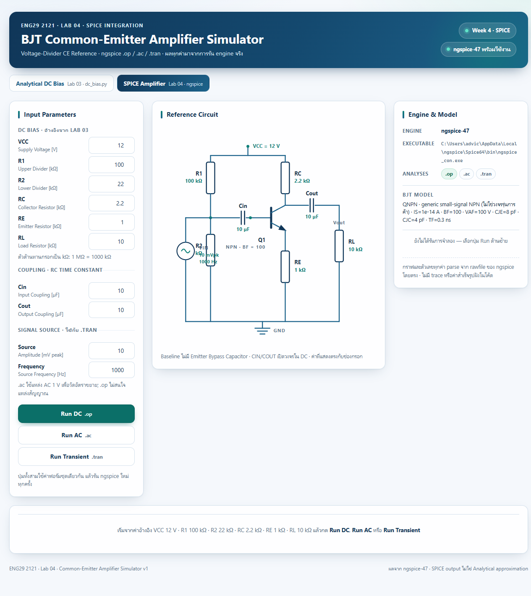

# BJT Amplifier Simulator v1 — Lab 04

Flask web app สำหรับ ENG29 2121 (2/2569) ที่รวม

- **Lab 03 — Analytical DC Bias**: Voltage Divider / Fixed / Emitter (3 โหมดเดิม ผลไม่เปลี่ยน)
- **Lab 04 — SPICE CE Amplifier**: รัน **ngspice จริง** `.op` / `.ac` / `.tran`
  แล้วแสดงผลและกราฟที่ render บนเซิร์ฟเวอร์ (SVG ล้วน ไม่มี JavaScript/CDN)

หน้าเว็บ: `/` = Lab 03, `/simulator` = Lab 04



> ทุกตัวเลขในหน้า `/simulator` มาจากการรัน ngspice จริง — ไม่มีค่า hardcode,
> ไม่มี mock plot และไม่มี waveform ที่วาดขึ้นเอง ดูหลักฐานได้ใน
> [`docs/validation.md`](docs/validation.md)

---

## Features

### Lab 04 (ใหม่)

- ฟอร์มเดียว ปุ่ม 3 แบบ: **Run DC (.op)**, **Run AC (.ac)**, **Run Transient (.tran)**
- วงจรอ้างอิง **CE voltage-divider** (ไม่มี emitter bypass capacitor) พร้อม `RL` หลัง `COUT`
- แสดง **engine status + version**, **BJT model**, **run status**, จำนวนข้อมูล, เวลารัน, ขนาด raw
- แสดง **netlist และ ngspice log** ที่ใช้จริงใน `<details> Netlist & ngspice log (provenance)`
- AC: Bode magnitude (dB) + phase (°) พร้อม gain, fL/fH (−3 dB), gain/phase @ ความถี่อ้างอิง
- Transient: Vin/Vout vs time พร้อม p-p, gain p-p, ทิศทางเฟส และหน่วย mV / ms บนแกน
- แยก **SPICE result** ออกจาก **Analytical reference** และอธิบายสมมติฐานที่ต่างกัน
- Error state จริง: input ผิด / engine หาย / ngspice ล้มเหลว → `role="alert"`, HTTP 200,
  ไม่มีตารางผล กราฟ หรือข้อความ “Run OK” ค้างอยู่

### Lab 03 (คงเดิม)

- คำนวณ DC bias จากสมการ Forward-Active, เลือกโหมดได้ 3 แบบ
- แสดงเฉพาะช่องที่โหมดนั้นใช้, validation รายโหมด, warning `cutoff` / `near_saturation`
- ผล Divider เดิม `VCE = 8.05 V`, `IC = 1.23 mA` ยังตรงกับ Lab 02 ทุกค่า

---

## Quick Start — เครื่องใหม่ (Fresh PC)

ต้องมี **Python 3.10+** และ PowerShell (Windows) — ไม่ต้องติดตั้ง ngspice เอง และไม่ต้องเป็น admin

### 1. Clone

```powershell
git clone https://github.com/b6827311-oss/BJT-Amplifier-Simulator-v1.git
cd BJT-Amplifier-Simulator-v1
```

### 2. ติดตั้งอัตโนมัติ

ดับเบิลคลิก `setup.cmd` หรือรันใน PowerShell:

```powershell
.\setup.cmd
```

`setup.cmd` เรียก PowerShell แบบ `-ExecutionPolicy Bypass` ให้เอง
(ไม่ต้องเปลี่ยน execution policy ของเครื่อง)
ถ้าอยากเรียก `.ps1` ตรง ๆ ให้ใช้
`powershell -NoProfile -ExecutionPolicy Bypass -File .\setup.ps1`

สคริปต์จะทำสิ่งนี้:

1. สร้าง `.venv` (ใช้ `py -3` ถ้ามี ไม่ก็ `python`)
2. `pip install -r requirements.txt` (Flask 3.1.3)
3. โหลด **ngspice 47** (`ngspice-47_64.7z`) จาก SourceForge พร้อม `7zr.exe`
4. ตรวจ **SHA-256** ของไฟล์ที่โหลด
   (`59225971BD68CDD1199443649AA4615A9E6D684933F205AB49006A3942518F5A`)
5. แตกไปที่ `%LOCALAPPDATA%\ngspice` (ไม่ต้องการสิทธิ์ admin)
6. รัน `ngspice_con.exe -v` และ unittest 42 รายการให้เอง

### 3. รันเซิร์ฟเวอร์

ดับเบิลคลิก `run.cmd` หรือรัน:

```powershell
.\run.cmd
```

จากนั้นเปิด:

- <http://127.0.0.1:5000/simulator> — Lab 04 SPICE simulator
- <http://127.0.0.1:5000/> — Lab 03 analytical DC bias

`run.ps1` ตั้งค่า `NGSPICE_BIN` ให้ชี้ตัวที่ `setup.ps1` ติดตั้ง และเรียก `run_app.py`

### ถ้าติดตั้ง ngspice เอง / ใช้ ngspice ที่มีอยู่แล้ว

`get_ngspice()` ใน `spice_engine.py` ค้นหาตามลำดับ:

1. environment variable `NGSPICE_BIN` (path ถึง exe หรือโฟลเดอร์ `bin`)
2. `ngspice_con` / `ngspice` ใน `PATH`
3. `<project>\tools\ngspice\Spice64\bin\`
4. `%LOCALAPPDATA%\ngspice\Spice64\bin\` (ตำแหน่งที่ `setup.ps1` ใช้)
5. `C:\Spice64\bin\`, `C:\ngspice\Spice64\bin\`, `C:\Program Files\ngspice*\...`

ตรวจสอบเองได้ด้วย:

```powershell
& "$env:LOCALAPPDATA\ngspice\Spice64\bin\ngspice_con.exe" -v
# ngspice-47 ...
```

หรือบังคับใช้ตัวอื่น:

```powershell
$env:NGSPICE_BIN = "C:\path\to\ngspice_con.exe"
.\run.ps1
```

ถ้าไม่มี ngspice เลย หน้า `/simulator` ยังเปิดได้ แต่จะโชว์ error ว่าไม่พบ engine
และ **จะไม่แสดงผลหรือกราฟปลอม**

---

## Portable USB (optional)

สร้างชุดสำหรับย้ายไปเครื่องอื่นแบบออฟไลน์:

ดับเบิลคลิก `make-portable.cmd` หรือรัน:

```powershell
.\make-portable.cmd
```

ผลที่ได้:

- `portable\BJT-Amplifier-Simulator-v1\` — โค้ด + ngspice + wheel ของ Flask ทั้งชุด
- `dist\BJT-Amplifier-Simulator-v1-portable.zip` — zip พร้อมคัดลอกใส่ USB

วิธีใช้บนเครื่องปลายทาง:

1. copy โฟลเดอร์/zip ออกจาก USB (ควร copy ออกจาก USB ก่อนรัน)
2. ต้องมี Python 3.10+ บนเครื่องปลายทาง
3. ดับเบิลคลิก `run.bat` — รอบแรกมันจะสร้าง `.venv` และ install Flask **จากโฟลเดอร์ `wheels`**
   โดยไม่ต้องใช้อินเทอร์เน็ต แล้วเปิด browser ให้เอง

> `make-portable.ps1` ต้องใช้อินเทอร์เน็ต **ตอนสร้าง** เพื่อ `pip download` wheel
> แต่หลังสร้างแล้วชุดใน USB ใช้ออฟไลน์ได้

---

## วิธีใช้ `/simulator`

1. ตรวจ **Engine status** ว่าขึ้น `ngspice-47 พร้อมใช้งาน`
2. กรอกค่าตามหน่วยที่แสดงในป้ายช่อง:
   `VCC` [V], `R1/R2/RC/RE/RL` [kΩ], `Cin/Cout` [µF],
   `Amplitude` [mV peak], `Frequency` [Hz]
3. กดปุ่มที่ต้องการ:
   - **Run DC (.op)** → ตาราง `VB, VE, VC, VCE, VBE, IB, IC, IE` + region
   - **Run AC (.ac)** → gain/fL/fH/phase + กราฟ Bode สองกราฟ
   - **Run Transient (.tran)** → waveform Vin/Vout + p-p gain + ทิศทางเฟส
4. ขยาย **Netlist & ngspice log (provenance)** เพื่อดูสิ่งที่ส่งเข้า engine และ log ที่ได้จริง

### ค่าเริ่มต้น (ใช้ทำ acceptance B2–B6)

| Parameter | ค่า |
|---|---:|
| `VCC` | 12 V |
| `R1`, `R2` | 100 kΩ, 22 kΩ |
| `RC`, `RE` | 2.2 kΩ, 1 kΩ |
| `RL` | 10 kΩ |
| `Cin`, `Cout` | 10 µF, 10 µF |
| Amplitude / Frequency | 10 mV peak / 1000 Hz |

### ผลอ้างอิงที่ตรวจแล้ว (ngspice 47)

| Analysis | ผลจริง |
|---|---|
| `.op` | `VCE 7.899956 V`, `IC 1.278193 mA`, `VBE 0.659658 V` (active) |
| `.ac` | 194 จุด, gain สูงสุด `4.860 dB (1.750×)`, `fL 1.825 Hz`, `fH 153.447 MHz`, `@1 kHz: 4.860 dB / −179.868°` |
| `.tran` (10 mV/1 kHz) | `Vin p-p 19.999 mV`, `Vout p-p 34.997 mV`, `1.749896×`, inverted |

ค่าข้างบน **ไม่เหมือน** analytical Lab 03 (`IC 1.229858 mA`, `VCE 8.052155 V`)
เพราะ ngspice ใช้ diode equation (`IS/BF/VAF`) และมี `RL`/coupling capacitor
ขณะที่ `dc_bias.py` สมมติ `VBE = 0.70 V` คงที่ ไม่มี load และไม่มี capacitor
ทั้งสองชุดแสดงแยกกันในหน้าเว็บ ไม่มีการแทนที่กัน

---

## วิธีใช้ `/` (Lab 03 เดิม)

เลือกโหมดแล้วกด **เปลี่ยนโหมด / โหลดฟอร์มใหม่** ก่อนกด **Calculate DC Bias**

| โหมด | ช่องที่ใช้ | ผลอ้างอิง |
|---|---|---|
| Voltage Divider | `VCC, R1, R2, RC, RE, β, VBE` | `IC 1.229858 mA`, `VCE 8.052155 V` |
| Fixed | `VCC, RB, RC, β, VBE` | `IC 1.130000 mA`, `VCE 9.514000 V` |
| Emitter | `VCC, RB, RC, RE, β, VBE` | `IC 1.026340 mA`, `VCE 8.705450 V` |

ฟอร์มรับตัวต้านทานเป็น **kΩ** (`1 MΩ = 1000 kΩ`); `app.py` แปลงเป็น Ω จุดเดียว
การแสดงผล: V และ mA 2 ตำแหน่ง, µA 1 ตำแหน่ง

---

## โมเดล Netlist และหน่วย

ทุก netlist สร้างจากค่าที่ผ่าน validation และแปลงเป็น SI แล้ว:

```text
VCC vcc 0 DC 12
VIN in 0 DC 0 AC 1 SIN(0 10m 1k)
R1 vcc vb 100k
R2 vb 0 22k
RC vcc vc 2.2k
RE ve 0 1k
CIN in vb 10u
COUT vc out 10u
RL out 0 10k
Q1 vc vb ve QNPN
.model QNPN NPN (IS=1e-14 BF=100 VAF=100 CJE=8p CJC=4p TF=0.3n)
.op | .ac dec 20 100m 500meg | .tran <tstep> <tstop>
.end
```

- `.ac`: วัด gain เป็น `V(out)/V(in)` ที่ node `in` (แหล่งสัญญาณ) เทียบ `out` เหนือ `RL`
  หา fL/fH จากจุด −3 dB เทียบยอดในช่วง 0.1 Hz – 500 MHz
- `.tran`: รันประมาณ 20 รอบสัญญาณ (clamp 0.005–1.0 s) แล้วตัด 20% แรกออกก่อนวัด p-p
- `.op`: มี `.save all @q1[ic] @q1[ib] @q1[ie] @q1[vbe]` เพื่ออ่านกระแส device จริง

แปลงหน่วย: kΩ → Ω, µF → F, mV → V **อยู่ใน `app.py` เท่านั้น** (`_parse_simulation`)

---

## โครงสร้างโปรเจกต์

```text
.
├── app.py                     # Flask HTTP layer: ฟอร์ม, kΩ/µF/mV → SI, route, error mapping
├── dc_bias.py                 # pure engineering core (Lab 02–03) — ไม่ import Flask
├── spice_engine.py            # ngspice adapter: ค้นหา exe, สร้าง netlist, รัน, อ่าน rawfile
├── plots.py                   # สร้าง SVG Bode/waveform + format_freq (server-side)
├── run_app.py                 # entry point สำหรับ run.ps1 / portable run.bat
├── setup.ps1 / setup.cmd      # ติดตั้ง venv + ngspice 47 บนเครื่องใหม่
├── run.ps1 / run.cmd          # รันเซิร์ฟเวอร์
├── make-portable.ps1 / .cmd   # สร้างชุด USB ออฟไลน์
│                              # (.cmd เรียก PS แบบ Bypass ให้ ไม่ติด ExecutionPolicy)
├── requirements.txt           # Flask==3.1.3
├── templates/
│   ├── index.html             # Lab 03
│   └── simulator.html         # Lab 04
├── static/style.css           # responsive, ไม่มี framework/asset ภายนอก
├── tests/
│   ├── test_dc_bias.py        # 10 tests (Lab 02)
│   ├── test_web.py            # 7 tests (Lab 02)
│   ├── test_spice_engine.py   # 15 tests (Lab 04)
│   ├── test_plots.py          # 5 tests (Lab 04)
│   └── test_app_simulator.py  # 5 tests (Lab 04)
├── docs/
│   ├── validation.md          # B1–B8 + Lab 02 evidence
│   ├── lab03-acceptance.md    # A1–A5
│   ├── reflection.md          # Lab 02 + Lab 04
│   ├── design-note.md
│   ├── test-log*.txt
│   ├── impeccable-*.json
│   └── screenshots/           # before/after + browser B2–B8
├── AGENTS.md
└── README.md
```

---

## Tests

```powershell
.\.venv\Scripts\python.exe -m unittest discover -s tests -v
```

ต้องได้ `Ran 42 tests ... OK` (Lab 03 เดิม 17 + Lab 04 ใหม่ 25)
ดู log จริงได้ที่ [`docs/test-log-lab04.txt`](docs/test-log-lab04.txt)

---

## เอกสารและหลักฐาน

- [Validation — B1–B8 (Lab 04)](docs/validation.md) ← ผลที่อ่านจริงจาก browser + ngspice
- [Lab 03 Acceptance A1–A5](docs/lab03-acceptance.md)
- [Reflection](docs/reflection.md) — คำตอบรายบุคคล + ส่วนที่ AI ทำ/นักศึกษาตรวจ
- [Design Note](docs/design-note.md)
- [Impeccable before/after](docs/impeccable-before-url.json),
  [after desktop](docs/impeccable-after-desktop.json),
  [after mobile](docs/impeccable-after-mobile.json)
- [Screenshots](docs/screenshots/) — `before/`, `after/`, `browser/`,
  `playwright/` (B1–B8 จาก Playwright MCP, 2026-11-24)
- [Submission — ข้อมูลส่งงาน](docs/submission.md) — checklist, rubric, คำตอบคำถามรายบุคคล
- [Playwright MCP setup](docs/mcp-playwright.md) — วิธีติดตั้ง/เรียก tool ที่ใช้ตรวจ B1–B8

---

## Submission

- **Repository:** <https://github.com/b6827311-oss/BJT-Amplifier-Simulator-v1>
- **Branch:** `main`
- **Lab 03 commit:** `ecf69a4` (*Initial commit*, seed)
- **Lab 04 commit SHA:** `46bc3d3f27a5bcc6148f97486d77999d1a6e90e8` (`46bc3d3` —
  *feat: add Lab 04 ngspice CE amplifier simulator with B1-B8 evidence and fresh-PC setup*)
- **Commit หลักฐาน Playwright MCP + เอกสารส่งงาน:** `466ab192e0cedb02ddef4fb76dbcad25a99c3374`
  (`466ab19` — *docs: add Playwright MCP B1-B8 evidence and submission package*)
- **วิธีรัน:** `.\setup.cmd` → `.\run.cmd` → <http://127.0.0.1:5000/simulator>
- **Browser acceptance:** B1–B8 ตรวจด้วย **Playwright MCP** (`@playwright/mcp` + Chrome)
  เมื่อ 2026-11-24 — ตารางค่าจริงอยู่ที่ [`docs/validation.md`](docs/validation.md) §1.1
  ภาพอยู่ใน [`docs/screenshots/playwright/`](docs/screenshots/playwright/)
- **ข้อมูลส่งงาน (checklist + rubric + คำตอบรายบุคคล):** [`docs/submission.md`](docs/submission.md)

**AI ช่วยทำอะไร:** เขียน `spice_engine.py`/`plots.py`, route `/simulator`–`/simulate`,
สคริปต์ติดตั้ง/พอร์ตเทเบิล, ปรับ CSS ตาม Impeccable และร่างตาราง B1–B8
**นักศึกษาต้องตรวจเอง:** สมการ/หน่วย/warning Lab 03, netlist และ model card,
ตัวเลข B1–B8 เทียบ log จริง, ความต่าง SPICE vs analytical และคำตอบรายบุคคลใน reflection

---

## Troubleshooting

| อาการ | วิธีแก้ |
|---|---|
| ไม่พบ ngspice | รัน `.\setup.ps1` ใหม่ หรือตั้ง `$env:NGSPICE_BIN` แล้ว `.\run.ps1` |
| หน้า `/simulator` ขึ้น “ไม่พบ ngspice” | ตรวจ `& "$env:LOCALAPPDATA\ngspice\Spice64\bin\ngspice_con.exe" -v` |
| `python: command not found` | ลง Python 3.10+ แล้วเปิด terminal ใหม่ (หรือใช้ `py -3`) |
| `ModuleNotFoundError: flask` | `.\.venv\Scripts\python.exe -m pip install -r requirements.txt` |
| port 5000 ถูกใช้ | ปิด process เก่าหรือแก้ port ใน `run_app.py` |
| GitHub Desktop โชว์โฟลเดอร์ OneDrive | **Remove** repo ตัวนั้นออกจาก Desktop แล้ว **Add Existing Repository** ที่ `C:\Users\advic\Projects\BJT-Amplifier-Simulator-v1` (คนละ local clone ของ remote เดียวกัน) |
| ห้าม commit ผ่าน CLI | ตาม `AGENTS.md`: ให้กด Commit/Push ใน GitHub Desktop เท่านั้น |
